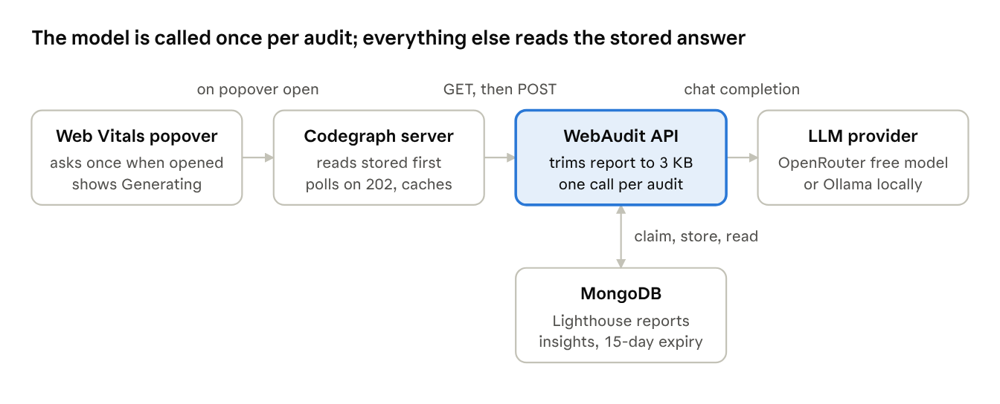

# WebAudit AI Insights: Change Log

Nov 18, 2026 · Sunit Sinha

## Summary

WebAudit can now explain a finished Lighthouse audit with an LLM, and codegraph shows that explanation in its Web Vitals popover. The model gets a trimmed report (about 3 KB instead of 300 KB), is called once per audit, and its answer is stored and reused.

It works with any OpenAI-compatible endpoint: OpenRouter free models in production, Ollama or LM Studio locally. Along the way two bugs were fixed: the existing report endpoints returned 500, and rate limits would have been shared by all visitors on Cloud Run. Everything is tested locally end to end; nothing is committed or deployed yet.

The first visitor to open the popover triggers the only model call for that audit; later visitors and repeat requests are answered from MongoDB and codegraph's cache.

## WebAudit: AI insights

Two new endpoints sit next to the existing audit routes in `D:\webaudit`. POST generates the explanation once and stores it; every later request reads the stored copy.

| Endpoint | What it does | Status codes |
| --- | --- | --- |
| `POST /api/v1/audits/:id/insights` | Generates insights once, stores them, returns them | 200 ready · 202 another request is generating · 404 no audit · 409 audit still running or no report · 503 no model configured · 429 provider rate limit · 502 model failed or unusable answer |
| `GET /api/v1/audits/:id/insights` | Returns the stored insights; never calls the model | 200 · 404 not generated yet |

How a POST is handled:

1. Load the audit and its stored Lighthouse reports (mobile and desktop).
2. Claim the job atomically in Mongo, so only one request generates per audit, across instances. A stuck claim expires after 3 × `LLM_TIMEOUT_MS`.
3. Trim each report to scores, core metrics and the top 10 failing or saving audits, with up to 5 rows of evidence each.
4. Call the model with a JSON schema. If the provider rejects schema-forced output, retry once without it; the prompt still carries the schema.
5. Parse the reply (code fences and extra text tolerated), validate it with zod, cap it at 8 issues, and store it with the model that actually answered.

Each issue has a metric, a cause, the evidence (Lighthouse audit id, URL or selector), a concrete fix, and an impact of high, medium or low. Stored insights expire with their audit (15 days).

Files in `src/agent-inference/`:

| File | Role |
| --- | --- |
| `findings.ts` | Trims a Lighthouse report to what the model needs |
| `insights.schema.ts` | zod schema for the model's answer (strict objects) |
| `agent-analysis.ts` | System prompt, OpenAI-compatible client, fallback models, reply parsing |
| `insights.model.ts` · `insights.repository.ts` | Mongo collection, atomic claim, complete and fail |
| `insights.service.ts` | The POST flow above; maps provider errors to safe messages |
| `insights.controller.ts` | HTTP status mapping |

Also added: routes and a separate insights rate limiter in `audit.routes.ts`, the `openai` package (v7.59), and `scripts/free-models.ts` (`npm run llm:free-models`), which lists OpenRouter's current free models with structured-output support first.

## Configuration

Insights are off unless `LLM_BASE_URL` and `LLM_MODEL` are both set; the rest of the API works either way. Empty values count as unset. The full template, with placeholders only, is `.env.sample`.

| Variable | Default | Purpose |
| --- | --- | --- |
| `LLM_BASE_URL` | unset | OpenAI-compatible endpoint: `https://openrouter.ai/api/v1`, `http://localhost:11434/v1` (Ollama), `http://localhost:1234/v1` (LM Studio) |
| `LLM_API_KEY` | unset | Provider key. Not needed for Ollama or LM Studio. On Cloud Run, keep it in Secret Manager |
| `LLM_MODEL` | unset | Model id, e.g. `nvidia/nemotron-3.5-super-vl:free` |
| `LLM_FALLBACK_MODELS` | unset | OpenRouter only: comma-separated models tried when the first is rate-limited or down |
| `LLM_TIMEOUT_MS` | 120000 | Per attempt; one retry follows a timeout |
| `LLM_APP_URL` | unset | Sent to OpenRouter as `HTTP-Referer` |
| `INSIGHTS_RATE_LIMIT_WINDOW_MS` | 3600000 | Window for the POST insights limit |
| `INSIGHTS_RATE_LIMIT_MAX` | 5 | POST insights requests per IP per window |
| `TRUST_PROXY_HOPS` | 1 | Proxies in front of the app (1 on Cloud Run and Railway; 0 when clients connect directly) |

Model choice, tested 2026-11-18 on OpenRouter's free tier:

| Model | Result |
| --- | --- |
| `perplexity/pplx-decider-v1.3:free` | Unusable: a decisions model, rejected by the chat endpoint |
| `nvidia/nemotron-3.5-super-vl:free` | Works; accurate, evidence-backed answers in 58–104 s. Now `LLM_MODEL` |
| `google/gemma-4-31b-it:free` | Rate-limited upstream (429); now the fallback |
| `inclusionai/ling-3.2-flash:free` | Timed out twice |

Free models change every few weeks. When the current one fails, run `npm run llm:free-models` and pick new values. A few dollars of OpenRouter credit on a paid model would answer in seconds.

## Bug fixes

Two existing bugs in WebAudit were fixed; the first was already breaking existing endpoints.

| Bug | Effect | Fix |
| --- | --- | --- |
| Stored reports came back from Mongo `.lean()` as BSON `Binary`, which zlib rejects | `GET /report` and `GET /report.html` returned 500 for every audit; insights failed the same way | `audit.repository.ts` converts the binary fields to `Buffer` when reading (`toBuffer`), so every caller gets bytes zlib accepts |
| No `trust proxy` setting | Behind Cloud Run every request appears to come from the proxy, so all visitors would share one rate limit: 20 audits a minute and 5 insights an hour in total | `app.ts` sets `trust proxy` from `TRUST_PROXY_HOPS` (default 1). Rate limits now count per visitor IP |

With `TRUST_PROXY_HOPS=0` the `X-Forwarded-For` header is ignored, so a client reaching the app directly cannot fake its address to dodge the limits.

## Codegraph integration

Codegraph's Web Vitals popover now shows the AI explanation of the latest audit, asked for only when someone opens the popover. Visitors who never open it cost nothing.

**Server** (`packages/server/src/vitals/web-vitals.service.ts`, `api/web-vitals.controller.ts`): new endpoint `GET /api/web-vitals/insights`.

- Waits for an audit that is still running, then reads WebAudit's stored insights with a free `GET`; only when none exist does it `POST` to generate.
- On `202`, or a stored `pending` record, it polls every 5 s for up to 4 minutes, under Cloud Run's 300 s request timeout.
- Simultaneous visitors share one request; a ready answer is cached with the audit; a failure is not retried for 5 minutes.
- Answers `ready` (summary, issues, model, date), `failed` (with a reason), `unconfigured` or `unavailable`. Issue text is validated and capped at 600 characters and 8 issues.
- Nothing new to configure: the model lives on WebAudit, and codegraph only needs `VITALS_SERVICE_URL`.

**Popover** (`packages/web/src/app/components/web-vitals/`): an AI insights section below the Mobile and Desktop tabs, since one explanation covers both.

- While waiting: a spinner and "Generating insights from the Lighthouse report. The first time can take a minute or two."
- When ready: the summary, then a collapsed "Top 3 of 8 issues" list. Each issue shows its impact, metric and a two-line cause, and expands to its fix and evidence.
- A footer names the model and time and says to check before acting.
- Hidden when WebAudit has no model; on failure it shows the reason and retries on the next open.
- Height: the existing design rule is that the popover never scrolls. Fully expanded, the section made it 1,538 px tall; collapsed it is 712 px, which fits a 768 px laptop screen.

Wiring: `WEB_VITALS_INSIGHTS_SOURCE` in `web-vitals.ts`, provided in `app.config.ts`. `DEPLOY.md` documents the flow.

## Testing and verification

All suites pass, typecheck and lint are clean, and the whole flow ran end to end locally with a real audit, local MongoDB and the real OpenRouter model.

| Suite | Tests | New |
| --- | --- | --- |
| WebAudit (vitest) | 34 pass | 20: findings, reply parsing, insights service, BSON `Binary`, proxy rate limits |
| Codegraph server (node:test) | 46 pass | 8: insights endpoint, caching, polling, failures |
| Codegraph web (Karma) | 45 pass | 8: popover states, top 3 issues, HTTP source |

End-to-end run of WebAudit against local MongoDB (Atlas rejects this PC's IP):

- Unknown audit: `404`. Insights before generation: `404`.
- A second POST during generation: `202 pending`.
- First POST: `200` after 72 s with 8 issues. Repeat POST: `200` in 6 ms from the stored copy.
- `/report` and `/report.html`: `200` after the Binary fix (`500` before).

In the browser, codegraph audited codegraph.sunitsinha.in through the local WebAudit (mobile performance 94, desktop 83). Opening the popover showed the generating state, then the summary and the collapsed issue list.

The answers were grounded. For sunitsinha.in, every claim matched the Lighthouse data: a 1,853 ms server response delaying the hero `h1`, a 236 ms long task in one Next.js chunk, the Umami script, and render-blocking CSS.

## Open items

The code is done; these steps are yours, in roughly this order.

- [ ] Rotate the OpenRouter key. It was printed in full during the session; put the new one in `.env`
- [ ] Commit both repos. WebAudit has no commits yet, so check `.gitignore` covers `.env` and `.env.example`; commit `.env.sample` instead
- [ ] Deploy WebAudit to Cloud Run with the `LLM_*` settings, the key in Secret Manager, and `TRUST_PROXY_HOPS=1` (the default)
- [ ] Set `_VITALS_SERVICE_URL` for codegraph's Cloud Build (it is empty in `cloudbuild.yaml`), then redeploy codegraph
- [ ] Optional: add this PC's IP to the Atlas access list to run WebAudit locally against Atlas
- [ ] Optional: drop the local `webaudit-e2e` test database and `.claude/launch.json` in codegraph if you don't want them
